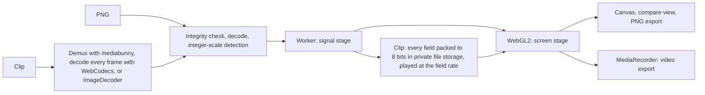

# Reference

How nijimi turns a PNG into a CRT picture, and the numbers it uses. For using the page, see [`README.md`](README.md).

## Pipeline

The signal stage runs in a Web Worker and is plain TypeScript, so every rule below is unit tested. The screen stage is a single WebGL2 fragment shader.

## Signal stage

Each picture row becomes a sampled line at four samples per color subcarrier cycle, or eight when the console's dot clock needs it to keep two samples per pixel. Pixels are area-weighted onto that grid, so a pixel lasts exactly as long as the console's dot clock says.

| Connection | Encoder                                                                   | Decoder                                                         |
| ---------- | ------------------------------------------------------------------------- | --------------------------------------------------------------- |
| RGB        | Each channel band-limited to 5.75 MHz                                     | None                                                            |
| Component  | Y at 5.75 MHz, color difference at 2.75 MHz                               | None                                                            |
| S-Video    | Chroma band-limited and modulated onto the subcarrier, separate from luma | Demodulation, chroma filter at the standard's chroma bandwidth  |
| Composite  | Luma and modulated chroma summed on one wire                              | Notch, 1-line comb or 2-line comb separation, then demodulation |
| RF         | Composite with optional ghost, noise and sound beat                       | Composite decoder with luma limited to 3 MHz                    |

Filters are second-order Butterworth sections run forward and backward, so they add no delay and their half-power point sits on the stated bandwidth. The composite notch is a Q=1 trap at the subcarrier.

PAL standards flip the V component every line. The simple PAL decoder shows the resulting Hanover bars when the hue is off; the delay-line decoder averages each line with the previous one and cancels the error.

### Subcarrier phase

The chroma phase of every line comes from the console clocks, not from a table of patterns. A console derives its pixel clock and its subcarrier from one master crystal, so each preset stores how many master cycles make one subcarrier cycle, one pixel and one line.

| Preset                    | Master cycles per subcarrier cycle, NTSC / PAL                | Dot divider           | Master cycles per line, NTSC        |
| ------------------------- | ------------------------------------------------------------- | --------------------- | ----------------------------------- |
| NES                       | 6 / 6                                                         | 4 (5 on PAL)          | 1364, one dot shorter on odd frames |
| SNES 256 and 512          | 6 / 4.8                                                       | 4 and 2               | 1364, one dot shorter on odd frames |
| Genesis H32 and H40       | 15 / 12                                                       | 10 and 8              | 3420                                |
| Master System             | 15 / 12                                                       | 10                    | 3420                                |
| PlayStation 256 to 640    | 15 / 12                                                       | 10, 8, 7, 5 and 4     | 3413                                |
| SG-1000                   | 3 / crystal over PAL subcarrier, not locked                   | 2                     | 684, 342 pixel clocks               |
| 32X                       | as Genesis H40                                                | 8                     | 3420                                |
| Atari 2600                | 1 NTSC, 3.546894 MHz over the PAL subcarrier                  | 1                     | 228 color clocks                    |
| Atari 7800 160 and 320    | 2 NTSC, 1.6 PAL                                               | 2 and 1               | 454                                 |
| Atari 5200 160 and 320    | 4 NTSC, 3.2 PAL                                               | 4 and 2               | 912, 228 color clocks               |
| Nintendo 64 320 and 640   | 13.6 NTSC, 11.2 PAL                                           | 8 and 4               | 3094 NTSC, 3178 PAL                 |
| Saturn 320, 352, 640, 704 | 7.5 or 8 NTSC; 26.6875 or 28.4375 MHz over the PAL subcarrier | 4 low-res, 2 high-res | 427 or 455 dots of 4 clocks         |
| Atari Jaguar 256 and 320  | 52/7 NTSC, 26.5939 MHz over the PAL subcarrier                | 5 and 4               | 1690 NTSC, 1702 PAL                 |

These give the behavior that shows on real sets: the NES chroma phase advances a third of a cycle per line, Genesis lines all share one phase so its artifacts stand still, and broadcast-timed video flips half a cycle per line. PAL-M presets use the console's 60 Hz timing with its clock locked to the PAL-M subcarrier.

When a pattern repeats over several frames, the averaged view blends the whole cycle in linear light, as the eye does at 60 Hz. The single-frame view shows one frame or one interlaced field.

## Standards

| Standard | Subcarrier               | Luma bandwidth | Chroma bandwidth        | Square-pixel clock |
| -------- | ------------------------ | -------------- | ----------------------- | ------------------ |
| NTSC     | 315/88 MHz, 3.579545 MHz | 4.2 MHz        | I 1.48 MHz, Q 0.465 MHz | 135/11 MHz         |
| PAL-B/G  | 4.43361875 MHz           | 5.0 MHz        | U and V 1.56 MHz        | 14.75 MHz          |
| PAL-M    | 3.57561149 MHz           | 4.2 MHz        | U and V 1.57 MHz        | 135/11 MHz         |

The standard does not give one chroma bandwidth. ITU-R BT.470-6, Table 2, item 2.6, gives an attenuation mask for each signal:

| Signal       | Mask, verbatim                            | Bandwidths that meet it | Used      |
| ------------ | ----------------------------------------- | ----------------------- | --------- |
| NTSC I       | `< 3 at 1.3`, `>= 20 at 3.6` dB at MHz    | 1.301 to 1.681 MHz      | 1.48 MHz  |
| NTSC Q       | `< 2 at 0.4`, `< 6 at 0.5`, `>= 6 at 0.6` | 0.450 to 0.481 MHz      | 0.465 MHz |
| PAL-M U, V   | `< 2 at 1.3`, `> 20 at 3.6`               | 1.460 to 1.682 MHz      | 1.57 MHz  |
| PAL-B/G U, V | `< 3 at 1.3`, `> 20 at 4`                 | 1.301 to 1.865 MHz      | 1.56 MHz  |

The ranges are for the filter nijimi uses, at 4, 8 and 16 samples per subcarrier cycle. Each bandwidth is the geometric centre of its range, which leaves the most room to both limits. A test runs a tone through the filter at every mask point and every sample rate and checks the bound. The table prints `E'U` beside the first limit and `E'V` beside the second; nijimi applies both limits to both signals.

The decoder filters chroma with the encoder's bandwidth. No standard sets a receiver's chroma filter, so this is a model choice.

## Console check

Every imported picture is checked against the selected preset after integer-scale detection: its native size against the preset's display modes, its colors on screen against the hardware limit, and the distinct values of each RGB channel against the palette's bits per channel. A check passes, needs a named hardware mode, or fails; a failing size lists the presets that draw it. The channel count is a necessary condition only: a picture can stay within 8 levels per channel and still use values a Genesis cannot produce.

| Preset            | Width                   | Lines NTSC and PAL-M                              | Lines PAL-B/G                               | Colors on screen                                                           | Levels per channel                 | Source                                                                                                                                                                                                                                                                                                                                                                                                                                                                                      |
| ----------------- | ----------------------- | ------------------------------------------------- | ------------------------------------------- | -------------------------------------------------------------------------- | ---------------------------------- | ------------------------------------------------------------------------------------------------------------------------------------------------------------------------------------------------------------------------------------------------------------------------------------------------------------------------------------------------------------------------------------------------------------------------------------------------------------------------------------------- |
| `nes`             | 256                     | 240, or the 224 a TV shows                        | same                                        | 25                                                                         | not checked                        | nesdev, Overscan: `always generates a 256x240 pixel picture`, `the commonly reported 256x224 resolution`; PPU palettes: 4 background and 4 sprite palettes of 4, `Entry 0 of each palette is unique in that it is transparent`, backdrop shared, so 1 + 8 times 3 = 25; the 64 outputs have no fixed RGB values                                                                                                                                                                             |
| `snes-256`        | 256                     | 224, 239; 448, 478 with interlace                 | same                                        | 256; up to 32768 with color math or direct color                           | 32                                 | fullsnes, SETINI: `0=224 Lines, 1=239 Lines`, `V-Scanning (0=Non Interlace, 1=Interlace)`; CGRAM: 5 bits each of blue, green and red, 00h to FFh; Direct Color Mode on 256-color BGs of modes 3, 4 and 7                                                                                                                                                                                                                                                                                    |
| `snes-512`        | 512                     | as `snes-256`                                     | same                                        | 256; up to 32768 with color math                                           | 32                                 | fullsnes, BG modes: `512-pix-hires` in modes 5 and 6, `Horizontal Pseudo 512 Mode`; `Mode 5/6 don't support screen addition/subtraction`; Hires and Pseudo 3-Layer Math: COLDATA addition applies to hi-res                                                                                                                                                                                                                                                                                 |
| `genesis-h32`     | 256                     | 224; 448 with interlace                           | 224; 240 in V30; 448, 480 with interlace    | 61; 183 with shadow/highlight                                              | 8; 15 with shadow/highlight        | plutiedev, Changing screen resolution: 256 or 320 wide, 224 or 448 high; VDP registers: `V30 mode only works properly on PAL systems`, `mode 2 (interlaced with higher resolution)`; Tiles and palettes: `four palettes on screen, and each palette consists of 16 colors`, `the first color is always transparent`, so 4 times 15 + 1 = 61; Kabuto's notes: palette word `----bbb-ggg-rrr-`; Shadow/highlight: `50% white and 50% black`, so 3 times 61 and 15 levels per channel, derived |
| `genesis-h40`     | 320                     | as `genesis-h32`                                  | same                                        | as `genesis-h32`                                                           | as `genesis-h32`                   | as `genesis-h32`                                                                                                                                                                                                                                                                                                                                                                                                                                                                            |
| `sms`             | 256                     | 192; 224 and 240 on the Master System II VDP      | same                                        | 32                                                                         | 4                                  | Charles MacDonald, msvdp-20021112: `--BBGGRR`, `up to 32 can be displayed on screen`; the 224 and 240-line modes `for the SMS 2 and GG VDP only`                                                                                                                                                                                                                                                                                                                                            |
| `ps1-256`         | 256                     | 1 to 240; up to 480 with interlace                | 1 to 288; up to 576 with interlace          | 32768; more with the 24-bit display                                        | 32; 256 with the 24-bit display    | psx-spx, GP1(08h): `0=256, 1=320, 2=512, 3=640`, `0=240, 1=480, when Bit5=1`, `Display Area Color Depth (0=15bit, 1=24bit)`; GP1(07h): `The number of lines is Y2-Y1`, fullscreen 240 NTSC and 288 PAL; 576 interlaced PAL is derived                                                                                                                                                                                                                                                       |
| `ps1-320`         | 320                     | as `ps1-256`                                      | same                                        | as `ps1-256`                                                               | as `ps1-256`                       | as `ps1-256`                                                                                                                                                                                                                                                                                                                                                                                                                                                                                |
| `ps1-368`         | 368                     | as `ps1-256`                                      | same                                        | as `ps1-256`                                                               | as `ps1-256`                       | as `ps1-256`                                                                                                                                                                                                                                                                                                                                                                                                                                                                                |
| `ps1-512`         | 512                     | as `ps1-256`                                      | same                                        | as `ps1-256`                                                               | as `ps1-256`                       | as `ps1-256`                                                                                                                                                                                                                                                                                                                                                                                                                                                                                |
| `ps1-640`         | 640                     | as `ps1-256`                                      | same                                        | as `ps1-256`                                                               | as `ps1-256`                       | as `ps1-256`                                                                                                                                                                                                                                                                                                                                                                                                                                                                                |
| `sg-1000`         | 256; 240 in text mode   | 192                                               | 192                                         | 15                                                                         | not checked                        | Texas Instruments, TMS9918A/TMS9928A/TMS9929A Video Display Processors Data Manual, 1982: `256 x 192 resolution`, `15 unique colors plus transparent`, Table 3-3 Screen Display Parameters: 256 active of 342 pixel clocks, 240 in Text mode; the palette is fixed analog levels with no RGB definition                                                                                                                                                                                     |
| `32x`             | 320                     | 224                                               | 240                                         | 256; 32768 in direct color mode                                            | 32                                 | 32XDK community wiki at 8e82fb0: Home, `Screen Resolutions: 320x224, 320x240`; Video, `NTSC = 224 lines`, `PAL = 240 lines`, `256 simultaneous colors` in packed pixel and run length modes, `32,768 simultaneous colors` in direct color mode with `five bits` per field; the frame buffer at `0x24000000 - 0x24020000` holds 128 KiB, so full-width direct color fits at most 204 lines, derived and not checked                                                                          |
| `atari-2600`      | 160                     | 192; other heights up to 259 with a custom kernel | 228; up to 309 with a custom kernel         | 4; 128 NTSC or 104 PAL with color changes on every line                    | not checked                        | Atari 2600 Specifications, astro.physik.uni-potsdam.de/~mwendt/2600scene/specs.html: `One color clock = 1 pixel`, `228 color clocks`, `160 pixels`, `Picture 192 228 scanlines`, `Frame Time 262 312`, `V-Sync 3`, `4 colors at once (one color per object)`, `128 colors (NTSC), 104 colors (PAL)`; Andrew Towers, TIA hardware notes: `3.58 MHz colour clock`; the line count is set by each game's kernel, so 259 and 309 are the frames less the 3 sync lines, derived                  |
| `atari-7800-160`  | 160                     | 1 to 240                                          | 1 to 260                                    | 25                                                                         | not checked                        | 8bitworkshop, Atari 7800 platform: `320×240 pixels, 25 colors on screen`, `8 palettes of 4 colors each, allowing for 25 simultaneous colors`; MAME a7800.cpp at 906a6cf, BSD-3-Clause: PAL visible window 260 lines; picture height is set by each game's display lists                                                                                                                                                                                                                     |
| `atari-7800-320`  | 320                     | 1 to 240                                          | 1 to 260                                    | 25                                                                         | not checked                        | 8bitworkshop, Atari 7800 platform: `320×240 pixels, 25 colors on screen`, `8 palettes of 4 colors each, allowing for 25 simultaneous colors`; MAME a7800.cpp at 906a6cf, BSD-3-Clause: PAL visible window 260 lines; picture height is set by each game's display lists                                                                                                                                                                                                                     |
| `atari-5200-160`  | 128, 160 or 192         | 1 to 240                                          | 1 to 240                                    | 9; 128 with color changes on every line; 256 in the GTIA 16-luminance mode | not checked                        | Avery Lee, Altirra Hardware Reference Manual: playfields `128`, `160` and `192 color clocks`; `The maximum height of a display list is thus always 240 scan lines. This is true even in PAL`; `nine write-only color registers`; `128 distinct colors` through the registers; `the GTIA can display 256 colors, this is only possible through the special 16 luminance mode`                                                                                                                |
| `atari-5200-320`  | 256, 320 or 384, hi-res | 1 to 240                                          | 1 to 240                                    | 9; 128 with color changes on every line; 256 in the GTIA 16-luminance mode | not checked                        | Avery Lee, Altirra Hardware Reference Manual: playfields `128`, `160` and `192 color clocks`; `The maximum height of a display list is thus always 240 scan lines. This is true even in PAL`; `nine write-only color registers`; `128 distinct colors` through the registers; `the GTIA can display 256 colors, this is only possible through the special 16 luminance mode`                                                                                                                |
| `n64-320`         | 320                     | 1 to 240; up to 480 with interlace                | same                                        | 32768; 16.7 million with a 32-bit frame buffer                             | 32; 256 with a 32-bit frame buffer | n64brew, Video Interface: TYPE `5/5/5/3 (16 bit color)` or `8/8/8/8 (32 bit color)`; `High resolution mode supports up to 480 lines (NTSC) while low resolution is 240 lines (NTSC)`; the VI scales the frame buffer, so other sizes are possible and not checked, and PAL takes the NTSC limits as no PAL figure was read                                                                                                                                                                  |
| `n64-640`         | 640                     | 1 to 240; up to 480 with interlace                | same                                        | 32768; 16.7 million with a 32-bit frame buffer                             | 32; 256 with a 32-bit frame buffer | n64brew, Video Interface: TYPE `5/5/5/3 (16 bit color)` or `8/8/8/8 (32 bit color)`; `High resolution mode supports up to 480 lines (NTSC) while low resolution is 240 lines (NTSC)`; the VI scales the frame buffer, so other sizes are possible and not checked, and PAL takes the NTSC limits as no PAL figure was read                                                                                                                                                                  |
| `saturn-320`      | 320                     | 224, 240; 448, 480 with interlace                 | 224, 240, 256; 448, 480, 512 with interlace | 2048                                                                       | 32; 256 with 24-bit color RAM      | Charles MacDonald, Sega Saturn hardware notes 2004-04-27, archived Sega Retro copy: CRAM `1024 words` or `2048 words` in `5:5:5`, or `1024 longs` in `8:8:8`; Mednafen vdp2.c, GPL, read for facts only: active heights 224 and 240 NTSC, 224, 240 and 256 PAL; interlaced heights are the doubles, derived; RGB bitmap modes are not read from any source and not modeled                                                                                                                  |
| `saturn-352`      | 352                     | 224, 240; 448, 480 with interlace                 | 224, 240, 256; 448, 480, 512 with interlace | 2048                                                                       | 32; 256 with 24-bit color RAM      | Charles MacDonald, Sega Saturn hardware notes 2004-04-27, archived Sega Retro copy: CRAM `1024 words` or `2048 words` in `5:5:5`, or `1024 longs` in `8:8:8`; Mednafen vdp2.c, GPL, read for facts only: active heights 224 and 240 NTSC, 224, 240 and 256 PAL; interlaced heights are the doubles, derived; RGB bitmap modes are not read from any source and not modeled                                                                                                                  |
| `saturn-640`      | 640                     | 224, 240; 448, 480 with interlace                 | 224, 240, 256; 448, 480, 512 with interlace | 2048                                                                       | 32; 256 with 24-bit color RAM      | Charles MacDonald, Sega Saturn hardware notes 2004-04-27, archived Sega Retro copy: CRAM `1024 words` or `2048 words` in `5:5:5`, or `1024 longs` in `8:8:8`; Mednafen vdp2.c, GPL, read for facts only: active heights 224 and 240 NTSC, 224, 240 and 256 PAL; interlaced heights are the doubles, derived; RGB bitmap modes are not read from any source and not modeled                                                                                                                  |
| `saturn-704`      | 704                     | 224, 240; 448, 480 with interlace                 | 224, 240, 256; 448, 480, 512 with interlace | 2048                                                                       | 32; 256 with 24-bit color RAM      | Charles MacDonald, Sega Saturn hardware notes 2004-04-27, archived Sega Retro copy: CRAM `1024 words` or `2048 words` in `5:5:5`, or `1024 longs` in `8:8:8`; Mednafen vdp2.c, GPL, read for facts only: active heights 224 and 240 NTSC, 224, 240 and 256 PAL; interlaced heights are the doubles, derived; RGB bitmap modes are not read from any source and not modeled                                                                                                                  |
| `game-boy`        | 160                     | 144                                               | 144                                         | 4                                                                          | not checked                        | Pan Docs at f7f7b06, CC0: `a 160×144 pixel LCD`, Specifications: `4 shades of green`                                                                                                                                                                                                                                                                                                                                                                                                        |
| `game-boy-pocket` | 160                     | 144                                               | 144                                         | 4                                                                          | not checked                        | Pan Docs: `4 shades of gray`; the Game Boy Light shares the Pocket's screen and palette, not separately sourced                                                                                                                                                                                                                                                                                                                                                                             |
| `game-boy-color`  | 160                     | 144                                               | 144                                         | 56                                                                         | 32                                 | Pan Docs, Specifications: `BG: 8 × 4, OBJ: 8 × 3`, `32768 colors (15-bit RGB)`                                                                                                                                                                                                                                                                                                                                                                                                              |
| `game-gear`       | 160                     | 144                                               | 144                                         | 32                                                                         | 16                                 | Charles MacDonald, msvdp-20021112: Game Gear CRAM `BBBBGGGGRRRR`, `Up to 4096 possible colors can be used, but only 32 can be shown at any given time`, the LCD shows the middle 160 pixels and 144 lines                                                                                                                                                                                                                                                                                   |
| `jaguar-320`      | 320                     | 1 to 240; up to 480 with interlace                | 1 to 288; up to 576 with interlace          | 65536; 16.7 million in RGB24                                               | 64; 256 in RGB24                   | Atari Jaguar Technical Reference, 1995, Jaguar Video & System Clocks: pixel divisor 4 gives `332` overscanned pixels and `pixels that are about square`, divisor 5 gives `266`; `a screen height of 240 lines for NTSC and 288 lines for PAL`; Jaguar Software Reference Manual 2.4, VMODE: `16-bit CRY`, `RGB16` with 5 red, 5 blue and 6 green bits, `RGB24` with eight bits each                                                                                                         |
| `jaguar-256`      | 256                     | 1 to 240; up to 480 with interlace                | 1 to 288; up to 576 with interlace          | 65536; 16.7 million in RGB24                                               | 64; 256 in RGB24                   | Atari Jaguar Technical Reference, 1995, Jaguar Video & System Clocks: pixel divisor 4 gives `332` overscanned pixels and `pixels that are about square`, divisor 5 gives `266`; `a screen height of 240 lines for NTSC and 288 lines for PAL`; Jaguar Software Reference Manual 2.4, VMODE: `16-bit CRY`, `RGB16` with 5 red, 5 blue and 6 green bits, `RGB24` with eight bits each                                                                                                         |

Custom timing has no console check.

## Sources

Each constant is checked against the document named here. Status is one of: primary, a standard or manufacturer document; community, a hardware reference built from measurements where no manufacturer document is public; derived, computed from other constants; model, a choice nijimi makes that no document sets.

| Constant                                               | Value                                                                                                                                                                                                                                | Source                                                                                                                                                                                                                                                                                                                                 | Status                                                                                                  |
| ------------------------------------------------------ | ------------------------------------------------------------------------------------------------------------------------------------------------------------------------------------------------------------------------------------ | -------------------------------------------------------------------------------------------------------------------------------------------------------------------------------------------------------------------------------------------------------------------------------------------------------------------------------------- | ------------------------------------------------------------------------------------------------------- |
| NTSC subcarrier                                        | 315/88 MHz                                                                                                                                                                                                                           | ITU-R BT.470-6, Table 2, item 2.11: `3 579 545 ± 10` Hz, `fsc = 455/2 fH`                                                                                                                                                                                                                                                              | primary; 315/88 MHz lies inside the tolerance                                                           |
| PAL-B/G subcarrier                                     | 4 433 618.75 Hz                                                                                                                                                                                                                      | BT.470-6, Table 2, item 2.11: `4 433 618.75 ± 5`                                                                                                                                                                                                                                                                                       | primary                                                                                                 |
| PAL-M subcarrier                                       | 3 575 611.49 Hz                                                                                                                                                                                                                      | BT.470-6, Table 2, item 2.11: `fsc = 909/4 fH`, Table 1, item 3: `15 734.264` Hz                                                                                                                                                                                                                                                       | primary, from the formula; the same cell prints `3 579 611.49`, which contradicts the formula beside it |
| Luma bandwidth                                         | 4.2 MHz M, 5 MHz B/G                                                                                                                                                                                                                 | BT.470-6, Table 1, item 6, nominal video bandwidth                                                                                                                                                                                                                                                                                     | primary                                                                                                 |
| Sound carrier                                          | +4.5 MHz M, +5.5 MHz B/G                                                                                                                                                                                                             | BT.470-6, Table 3, item 2: sound carrier relative to vision carrier                                                                                                                                                                                                                                                                    | primary                                                                                                 |
| Luma weights                                           | 0.299, 0.587, 0.114                                                                                                                                                                                                                  | BT.470-6, Table 2, item 2.4; ITU-R BT.601-7, section 2.5.1                                                                                                                                                                                                                                                                             | primary                                                                                                 |
| U and V scale                                          | 0.493, 0.877                                                                                                                                                                                                                         | BT.470-6, Table 2, item 2.5                                                                                                                                                                                                                                                                                                            | primary                                                                                                 |
| I and Q axes                                           | U and V rotated 33 degrees                                                                                                                                                                                                           | BT.470-6, Table 2, item 2.9: `sin(2πfsc t + 33°)`; with item 2.5 this gives item 2.5's I and Q weights to two places, which a test checks                                                                                                                                                                                              | primary                                                                                                 |
| Field rate                                             | subcarrier / (lines per frame x cycles per line - short-line cycles / 2)                                                                                                                                                             | derived from the console timing rows; the worked values in `fieldRate.test.ts` give NES 60.0988 and 50.0070 Hz, Genesis 59.9227 Hz and SNES 60.0988 Hz                                                                                                                                                                                 | derived                                                                                                 |
| Clip storage                                           | no length limit; decoded frames and fields in the origin private file system, memory when it is refused; 1 to 8 signal workers, half the cores                                                                                       | device storage and memory                                                                                                                                                                                                                                                                                                              | model                                                                                                   |
| Packed signal                                          | 8 bits per sample over -0.25 to 1.25                                                                                                                                                                                                 | room for filter ringing below black and above white; one step is 1.5/255                                                                                                                                                                                                                                                               | model                                                                                                   |
| Chroma bandwidths                                      | see above                                                                                                                                                                                                                            | BT.470-6, Table 2, item 2.6                                                                                                                                                                                                                                                                                                            | primary mask; the value inside it is a model choice                                                     |
| Component and RGB bandwidths                           | Y and RGB 5.75 MHz, color difference 2.75 MHz                                                                                                                                                                                        | ITU-R BT.601-5, Figure 3: `Specification for a luminance or RGB signal filter`, passband edge 5.75 MHz; Figure 4: `colour-difference signal filter`, 2.75 MHz                                                                                                                                                                          | primary                                                                                                 |
| Display gamma                                          | 2.4                                                                                                                                                                                                                                  | ITU-R BT.1886, Annex 1: `γ = 2.40`, footnote 4: a satisfactory match to the legacy CRT display                                                                                                                                                                                                                                         | primary                                                                                                 |
| sRGB encoding                                          | 12.92, 1.055, 1/2.4, 0.0031308                                                                                                                                                                                                       | W3C CSS Color Module Level 4, sRGB transfer function                                                                                                                                                                                                                                                                                   | primary                                                                                                 |
| NES master clock                                       | 6 times the subcarrier, NTSC and PAL                                                                                                                                                                                                 | nesdev wiki, Cycle reference chart: `21.477272 MHz`, `26.601712 MHz`; `master clocks per PPU dot` 4 and 5                                                                                                                                                                                                                              | community; 21.477272 / 3.579545 = 6 and 26.6017125 / 4.43361875 = 6 are derived                         |
| NES line and frame                                     | 341 dots, 262 or 312 lines, odd frames one dot short                                                                                                                                                                                 | nesdev wiki, Cycle reference chart: `341 × 262`, `341 × 312`, `pre-render line is one dot shorter in every odd frame`; PPU frame timing                                                                                                                                                                                                | community                                                                                               |
| SNES clocks                                            | master 6 times NTSC, 4.8 times PAL; dot master / 4                                                                                                                                                                                   | fullsnes, SNES Timing Oscillators: `NTSC dot clock 5.36931750MHz (21.47727MHz/4)`, `PAL master clock 21.2813700MHz (17.7344750MHz*6/5)`; SNESdev wiki, Timing: `4.8 times chroma`                                                                                                                                                      | community                                                                                               |
| SNES line                                              | 1364 master cycles, 1360 on line 240 of odd frames                                                                                                                                                                                   | fullsnes, Long and Short Scanlines; SNESdev wiki, Timing                                                                                                                                                                                                                                                                               | community; the four 5-cycle dots of each line fall in hblank, so visible dots stay 4 cycles             |
| SNES 512 mode                                          | dot master / 2                                                                                                                                                                                                                       | fullsnes, Hires: main and sub screen give the half-pixels                                                                                                                                                                                                                                                                              | community                                                                                               |
| Genesis and Master System master                       | 15 times the subcarrier NTSC, 12 times PAL                                                                                                                                                                                           | SMS Power, Clock Rate: `53.6931MHz. This is divided by 15`, `53.2034MHz`, subcarrier `obtained by dividing it by 12`                                                                                                                                                                                                                   | community                                                                                               |
| Genesis line and dots                                  | 3420 master cycles; H40 every 8, H32 every 10                                                                                                                                                                                        | Kabuto's hardware notes, plutiedev mirror: `one pixel every 8 cycles`, `one pixel every 10 cycles (3420 master clock ticks`; `262 total`, `313 total`                                                                                                                                                                                  | community; H40 has longer dots only in hblank                                                           |
| Master System line                                     | 342 dots, 262 or 313 lines                                                                                                                                                                                                           | Charles MacDonald, SMS VDP documentation, msvdp-20021112: `a scanline consists of 342 pixels`, `262 scanlines`, `313 scanlines`                                                                                                                                                                                                        | community                                                                                               |
| PlayStation clocks                                     | 53.693175 and 53.203425 MHz, 15 and 12 times the subcarrier                                                                                                                                                                          | psx-spx, GPU Timings, Nominal Video Clock; Pinouts: `53.69MHz (GPU Clock) (div15 = NTSC color clock)`, `53.20MHz (GPU Clock) (div12 = PAL color clock)`                                                                                                                                                                                | community                                                                                               |
| PlayStation line                                       | 3413 or 3406 cycles, 263 or 314 lines, dot divider 10, 8, 7, 5 or 4 for 256, 320, 368, 512 or 640 wide                                                                                                                               | psx-spx, GPU Timings, Dotclocks: `/10`, `/8`, `/7`, `/5`, `/4`; GP1(08h)                                                                                                                                                                                                                                                               | community                                                                                               |
| SG-1000 clocks and lines                               | 10.738635 MHz crystal, pixel clock crystal / 2, 342 pixel clocks per line, 262 or 313 lines                                                                                                                                          | TMS9918A data manual, 3.6: `a 10.738635 (± 0.005) MHz crystal`, `divided by two to generate the pixel clock`; 3.6.2: `262 lines per frame`, TMS9929A `313 lines`; Figure 3-x: the TMS9929A takes a separate `BURST CRYSTAL (4,43 MHz)`                                                                                                 | primary; on PAL the pixel clock is not locked to the subcarrier                                         |
| 32X timing                                             | the Genesis H40 dot clock and line                                                                                                                                                                                                   | none read; the 32X picture is 320 wide and overlaid on the Mega Drive picture                                                                                                                                                                                                                                                          | derived, unverified                                                                                     |
| Mega-CD                                                | no preset                                                                                                                                                                                                                            | no source read on how it outputs video                                                                                                                                                                                                                                                                                                 | unverified, not added                                                                                   |
| Atari Jaguar clocks and lines                          | video clock 26.590906 MHz NTSC, 26.593900 MHz PAL; horizontal period 63.5555 us or 64.0 us, so 1690 or 1702 clocks; 524 or 624 half-lines non-interlaced, so 262 or 312 lines; pixel clock is the video clock over the VMODE divisor | Atari Jaguar Technical Reference, 1995, Video Timings table and Jaguar Video & System Clocks; used with the owner's approval recorded in decisions.md                                                                                                                                                                                  | manufacturer document                                                                                   |
| Handheld timing                                        | square pixels: half the square-pixel clock, a broadcast line length                                                                                                                                                                  | none: handhelds have no TV output; picking one switches the connection to RGB and the screen to the handheld LCD look                                                                                                                                                                                                                  | model                                                                                                   |
| Atari Lynx                                             | no preset                                                                                                                                                                                                                            | community notes confirm `160x102` but no source for its palette or colors on screen was read; the Epyx Handy specification has an unclear redistribution status                                                                                                                                                                        | unverified, not added                                                                                   |
| Virtual Boy                                            | no preset                                                                                                                                                                                                                            | the Sacred Tech Scroll page returned 404 and no other source was read                                                                                                                                                                                                                                                                  | unverified, not added                                                                                   |
| Sega Nomad                                             | covered by the Genesis presets                                                                                                                                                                                                       | a portable Mega Drive; no separate source read                                                                                                                                                                                                                                                                                         | derived                                                                                                 |
| Atari 2600 clocks                                      | color clock 3.579545 MHz NTSC, 3.546894 MHz PAL; one pixel per color clock                                                                                                                                                           | Atari 2600 Specifications: `Video Color Clock: 3.579545 MHz (NTSC), 3.546894 MHz (PAL)`                                                                                                                                                                                                                                                | community                                                                                               |
| Atari 7800 clocks and lines                            | pixel clock 14.31818 / 2 MHz NTSC, 14.187576 / 2 MHz PAL; 454 clocks per line; 263 or 313 lines                                                                                                                                      | MAME a7800.cpp at 906a6cf, BSD-3-Clause: `set_raw(14'318'180/2, 454, 0, 320, 263`, `set_raw(14'187'576/2, 454, 0, 320, 313`; pineight, Dot clock rates: 160 px at 3.58 MHz, `Atari 7800 (hi-res, 320px)` at 7.16 MHz                                                                                                                   | community                                                                                               |
| Atari 5200 clocks and lines                            | master 14.31818 MHz NTSC, 14.18757 MHz PAL; 114 machine cycles of 8 master clocks per line; 262 or 312 lines                                                                                                                         | Altirra Hardware Reference Manual, Table 6, ANTIC display timing                                                                                                                                                                                                                                                                       | community                                                                                               |
| Nintendo 64 clocks and lines                           | VI clock 13.6 or 11.2 times the subcarrier; pixel clock one quarter of it for 640 wide; H_TOTAL 3094 or 3178 quarter-pixel units; V_TOTAL 526 or 626 half-lines, so 263 or 313 lines                                                 | n64brew, Video Interface: `NTSC N64 has 13.6 VI clocks per chroma period`, `PAL N64 has 11.2 clocks per chroma period`, `227.5 × 13.6 = 3094`, `283.75 x 11.2 = 3178`, `the resulting pixel clock is 1/4 the data rate`, `NTSC/MPAL (non-interlaced: 525`, `PAL (non-interlaced: 625`; pineight: `Nintendo 64 (320px)` at 1071/176 MHz | community                                                                                               |
| Saturn clocks and lines                                | 26.8465875 MHz or 28.63636 MHz NTSC, pixels at one quarter; 427 or 455 dots per line; 263 or 313 lines; PAL 26.6875 or 28.4375 MHz                                                                                                   | Charles MacDonald, Sega Saturn hardware notes: `26.8465875 MHz`, `28.63636 MHz`, `render pixels at a rate of 1/4th of the system clock`, timer `1-426, for a 320/640 pixel display`, `1-454, for a 352/704 pixel display`, `263 lines`, `313 lines`; Mednafen ss.c and vdp2.c, GPL, facts only: PAL master `1734687500` over 61 or 65  | community; PAL clocks from an emulator only                                                             |
| Square-pixel clock                                     | 135/11 MHz, 14.75 MHz                                                                                                                                                                                                                | 780 and 944 times the line rate; pineight, Dot clock rates: `12.27 MHz, 135/11 MHz, Square interlaced pixels`                                                                                                                                                                                                                          | derived convention                                                                                      |
| Pixel aspect ratio                                     | 8:7, 32:35                                                                                                                                                                                                                           | square-pixel clock over dot clock; nesdev wiki, PAL video, gives `1.143:1` for NTSC and `1.386:1` for PAL NES, which tests match                                                                                                                                                                                                       | derived                                                                                                 |
| PAL-M console timing                                   | 60 Hz console timing locked to the PAL-M subcarrier                                                                                                                                                                                  | none found                                                                                                                                                                                                                                                                                                                             | model, unverified                                                                                       |
| RF ghost, noise, sound beat level, RF luma limit 3 MHz | 1.5 µs and 0.35, sigma 0.1, 0.06, 3 MHz                                                                                                                                                                                              | none                                                                                                                                                                                                                                                                                                                                   | model                                                                                                   |
| Notch Q, comb filters, Butterworth order               | Q 1, 1-line and 2-line comb, second order run twice                                                                                                                                                                                  | none                                                                                                                                                                                                                                                                                                                                   | model                                                                                                   |
| Overscan crop                                          | 5 percent per edge                                                                                                                                                                                                                   | none read                                                                                                                                                                                                                                                                                                                              | model, unverified                                                                                       |
| VP9 level for an undefined `vpcC` level                | Lowest level whose maximum luma picture size holds the coded frame: 36 864 for level 1 up to 35 651 584 for level 6, else 6.2                                                                                                        | WebM Project, VP9 Levels and Decoder Testing, table `VP9 Levels`; VP Codec ISO Media File Format Binding, `level` field: value 0 is `Undefined`, 10 is level 1                                                                                                                                                                         | primary; picture size only, since a decoder config carries no frame rate                                |

## Screen stage

| Control   | Effect                                                                                                       |
| --------- | ------------------------------------------------------------------------------------------------------------ |
| Gamma     | Signal to light with the chosen exponent, 2.4 by default, then encoded for an sRGB display                   |
| Scanlines | Gaussian beam per line, wider for bright lines and narrower for dark ones                                    |
| Mask      | Aperture grille, slot mask with staggered gaps every 4 rows, or shadow mask with triads shifted every 2 rows |
| Bloom     | Light spread from neighboring samples and lines                                                              |
| Curvature | Barrel warp with black corners                                                                               |
| Overscan  | Crops 5 percent from each edge, the action-safe area                                                         |

## Screen models

A screen model sets the mask, mask pitch, mask strength, scanline strength, bloom and curvature together. Moving any of those controls afterwards switches the model to Custom; a shared link that carries the model and its own values keeps the model.

| Model                           | Mask            | Pitch | Strength | Scanlines | Bloom | Curvature | What it approximates                                                 |
| ------------------------------- | --------------- | ----- | -------- | --------- | ----- | --------- | -------------------------------------------------------------------- |
| Consumer TV, shadow mask        | shadow          | 2     | 0.5      | 0.3       | 0.35  | 0.25      | MiSTer `Consumer TV (Generic)`; RetroTINK `Consumer-1`, `Consumer-2` |
| Consumer TV, aperture grille    | aperture grille | 2     | 0.4      | 0.4       | 0.3   | 0.15      | RetroTINK `Consumer Trinitron`, MiSTer `Sony Trinitron`              |
| Consumer TV, slot mask          | slot            | 2     | 0.45     | 0.35      | 0.3   | 0.2       | RetroTINK `Consumer Slot Mask`, `Slot Mask`                          |
| Professional monitor, PVM-style | aperture grille | 1     | 0.35     | 0.8       | 0.15  | 0.05      | RetroTINK `PVM-600`, MiSTer `Sony PVM (Generic)`                     |
| Broadcast monitor, BVM-style    | aperture grille | 1     | 0.25     | 0.95      | 0.1   | 0         | RetroTINK `BVM`, `BVM 1000`                                          |
| PC and VGA monitor              | shadow          | 1     | 0.3      | 0.9       | 0.1   | 0.05      | MiSTer `PC Monitor (Generic)`                                        |
| Arcade monitor                  | shadow          | 2     | 0.45     | 0.7       | 0.25  | 0.2       | MiSTer `Mitsubishi Megaview XC-3315C`                                |
| Handheld LCD                    | LCD grid        | 1     | 0.6      | 0         | 0     | 0         | MiSTer LCD styles for the Game Boy family                            |

Sources for the names: the RetroTINK-4K and RetroTINK-5X Pro pages of the ConsoleMods wiki, and `MiSTer-devel/ShadowMasks_MiSTer` at 9f0948c. Every value in the table is a model choice: no datasheet or service manual giving mask pitch, beam width or bloom for these sets was read. The masks are drawn by nijimi, not copied from the scaler files. White points such as D93 are not offered, because no primary source for their chromaticity was read.

## Tests

The suite crosses 24 dither patterns, from the checkerboard and Bayer matrices to Floyd-Steinberg, Atkinson, Jarvis, Judice and Ninke, Stucki, Burkes, the three Sierra filters, blue noise and white noise, with every connection, standard and console preset, and checks that each one keeps its average brightness and stays in range. Targeted tests cover the techniques consoles relied on: column dither blending into a solid color, artifact color, checkerboard shadows, flicker transparency, dot crawl cycles, SNES pseudo hi-res, interlace, chroma smear, pixel aspect ratios, comb against notch separation, PAL phase alternation, RF artifacts, gamma, beam width, masks and overscan. Expected values come from filter theory, the standards above, or hand-worked examples, never from the code under test.
