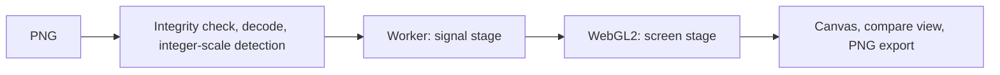

# Reference

How nijimi turns a PNG into a CRT picture, and the numbers it uses. For using the page, see [`README.md`](README.md).

## Pipeline

The signal stage runs in a Web Worker and is plain TypeScript, so every rule below is unit tested. The screen stage is a single WebGL2 fragment shader.

## Signal stage

Each picture row becomes a sampled line at four samples per color subcarrier cycle, or eight when the console's dot clock needs it to keep two samples per pixel. Pixels are area-weighted onto that grid, so a pixel lasts exactly as long as the console's dot clock says.

| Connection | Encoder                                                                   | Decoder                                                         |
| ---------- | ------------------------------------------------------------------------- | --------------------------------------------------------------- |
| RGB        | Each channel band-limited to 5.75 MHz                                     | None                                                            |
| Component  | Y at 5.75 MHz, color difference at 2.75 MHz                               | None                                                            |
| S-Video    | Chroma band-limited and modulated onto the subcarrier, separate from luma | Demodulation, 1.3 MHz chroma filter                             |
| Composite  | Luma and modulated chroma summed on one wire                              | Notch, 1-line comb or 2-line comb separation, then demodulation |
| RF         | Composite with optional ghost, noise and sound beat                       | Composite decoder with luma limited to 3 MHz                    |

Filters are second-order Butterworth sections run forward and backward, so they add no delay and their half-power point sits on the stated bandwidth. The composite notch is a Q=1 trap at the subcarrier.

PAL standards flip the V component every line. The simple PAL decoder shows the resulting Hanover bars when the hue is off; the delay-line decoder averages each line with the previous one and cancels the error.

### Subcarrier phase

The chroma phase of every line comes from the console clocks, not from a table of patterns. A console derives its pixel clock and its subcarrier from one master crystal, so each preset stores how many master cycles make one subcarrier cycle, one pixel and one line.

| Preset                  | Master cycles per subcarrier cycle, NTSC / PAL | Dot divider  | Master cycles per line, NTSC        |
| ----------------------- | ---------------------------------------------- | ------------ | ----------------------------------- |
| NES                     | 6 / 6                                          | 4 (5 on PAL) | 1364, one dot shorter on odd frames |
| SNES 256 and 512        | 6 / 4.8                                        | 4 and 2      | 1364, one dot shorter on odd frames |
| Genesis H32 and H40     | 15 / 12                                        | 10 and 8     | 3420                                |
| Master System           | 15 / 12                                        | 10           | 3420                                |
| PlayStation 256 and 320 | 15 / 12                                        | 10 and 8     | 3413                                |

These give the behavior that shows on real sets: the NES chroma phase advances a third of a cycle per line, Genesis lines all share one phase so its artifacts stand still, and broadcast-timed video flips half a cycle per line. PAL-M presets use the console's 60 Hz timing with its clock locked to the PAL-M subcarrier.

When a pattern repeats over several frames, the averaged view blends the whole cycle in linear light, as the eye does at 60 Hz. The single-frame view shows one frame or one interlaced field.

## Standards

| Standard | Subcarrier               | Luma bandwidth | Chroma bandwidth     | Square-pixel clock |
| -------- | ------------------------ | -------------- | -------------------- | ------------------ |
| NTSC     | 315/88 MHz, 3.579545 MHz | 4.2 MHz        | I 1.3 MHz, Q 0.5 MHz | 135/11 MHz         |
| PAL-B/G  | 4.43361875 MHz           | 5.0 MHz        | U and V 1.3 MHz      | 14.75 MHz          |
| PAL-M    | 3.57561149 MHz           | 4.2 MHz        | U and V 1.3 MHz      | 135/11 MHz         |

Color conversion uses the BT.601 luma weights 0.299, 0.587 and 0.114. The subcarrier frequencies are checked by tests against their line-rate relations: 455/2 times the 525-line rate for NTSC, 1135/4 plus 1/625 times 15625 Hz for PAL-B/G, and 909/4 times the PAL-M line rate.

The pixel aspect ratio follows from the dot clock and the square-pixel clock: 8:7 for 256-wide NTSC consoles and 32:35 for Genesis H40.

## Screen stage

| Control   | Effect                                                                                                       |
| --------- | ------------------------------------------------------------------------------------------------------------ |
| Gamma     | Signal to light with the chosen exponent, 2.4 by default, then encoded for an sRGB display                   |
| Scanlines | Gaussian beam per line, wider for bright lines and narrower for dark ones                                    |
| Mask      | Aperture grille, slot mask with staggered gaps every 4 rows, or shadow mask with triads shifted every 2 rows |
| Bloom     | Light spread from neighboring samples and lines                                                              |
| Curvature | Barrel warp with black corners                                                                               |
| Overscan  | Crops 5 percent from each edge, the action-safe area                                                         |

## Tests

The suite crosses 24 dither patterns, from the checkerboard and Bayer matrices to Floyd-Steinberg, Atkinson, Jarvis, Judice and Ninke, Stucki, Burkes, the three Sierra filters, blue noise and white noise, with every connection, standard and console preset, and checks that each one keeps its average brightness and stays in range. Targeted tests cover the techniques consoles relied on: column dither blending into a solid color, artifact color, checkerboard shadows, flicker transparency, dot crawl cycles, SNES pseudo hi-res, interlace, chroma smear, pixel aspect ratios, comb against notch separation, PAL phase alternation, RF artifacts, gamma, beam width, masks and overscan. Expected values come from filter theory, the standards above, or hand-worked examples, never from the code under test.
